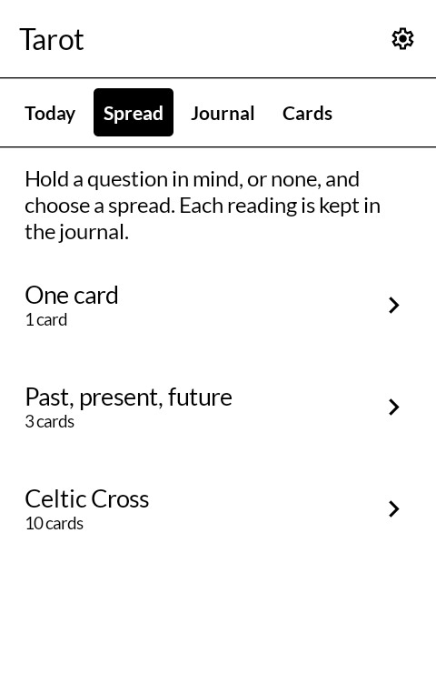
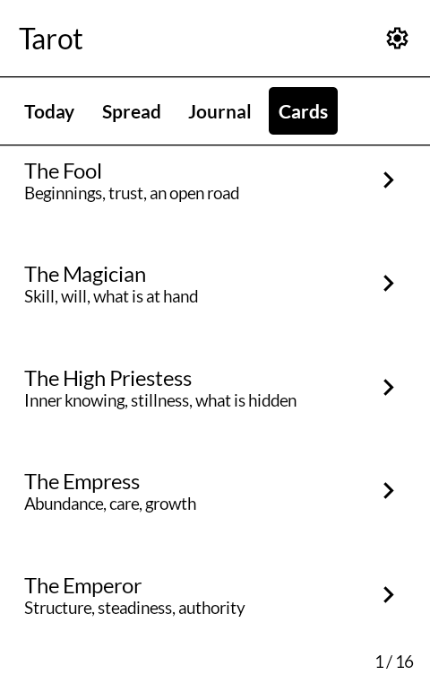
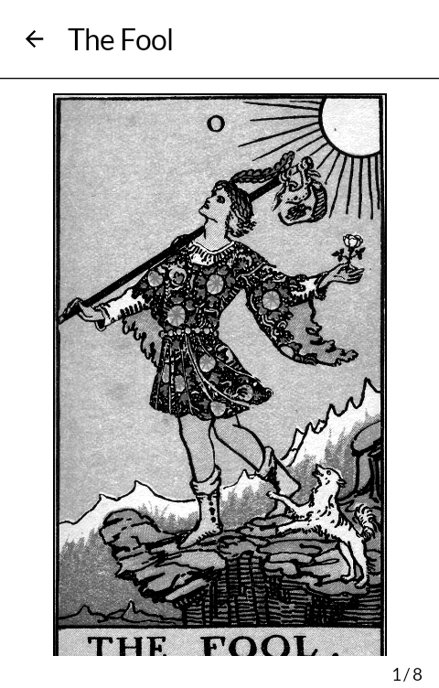
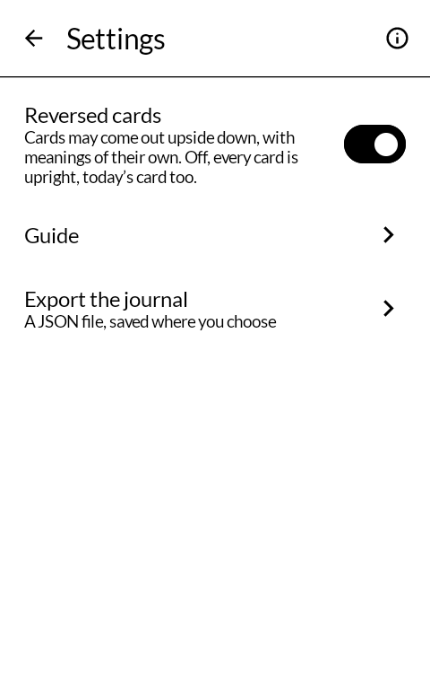

# Tarot

A tarot deck for the [Mudita Kompakt](https://mudita.com/products/kompakt/): a card for the day,
three spreads, a journal of readings, and the 1909 Rider-Waite-Smith pictures in sixteen greys.
It will install on any Android 12 device.

| | |
|---|---|
|  |  |
|  |  |

## Using it

- **Today** shows one card for the day: the same card all day, on any phone, and a different one
  tomorrow. **Keep in the journal** saves it there.
- **Spread** draws one card; past, present and future; or Waite's Celtic Cross of ten. Each place
  in a spread is named and read on its own, and the whole reading goes into the journal as soon
  as it is drawn, with the date. **Draw again** draws a new one beside it.
- **Journal** lists every reading, newest first. Open one to read it again, add or change a note,
  or delete it. Delete asks for a second tap, and forgets itself after four seconds.
- **Cards** lists all 78 in the order of the deck.
- **Tap a card** to see it on its own page with its name and both meanings, the one for how it
  was drawn first. Tap the picture again to see it whole: double-tap zooms in a step where you
  tap, a pinch zooms to the nearest step, and a drag moves the zoomed card. Each step is one
  redraw; nothing follows the finger.
- **Settings** turns reversed cards on or off (on by default; off, every card is upright, today's
  too), opens a short **Guide** to the deck and the spreads, and exports the journal as a JSON
  file through the phone's own file picker.

Cards are shuffled with `SecureRandom`. The card for a day is worked out from the date alone, so
it needs nothing stored and nothing fetched.

## The pictures and the words

The pictures are Pamela Colman Smith's, from the deck Rider published in London in 1909, taken
from scans of an original 1909 "Roses & Lilies" printing on Wikimedia Commons, which are in the
public domain. Here they are greyscale from the 1909 scans, sixteen greys for this screen, kept at
about the scans' own size so the zoom shows her linework. [ART.md](ART.md) says where each
file came from and what was done to it.

The meanings are written for this app, in plain words, drawing on A. E. Waite's *The Pictorial
Key to the Tarot* (1910), which is also in the public domain. They describe what a card is about;
they do not predict anything.

The art makes the APK about 26 MB.

## Building

```
./gradlew assembleDebug
```

A release build needs a keystore at `signing/signing.keystore` with a matching
`signing/signing.properties`. There is no fallback key in this repository: without one, a
release build comes out unsigned rather than wrongly signed.

`./gradlew testDebugUnitTest` runs the tests: the card for a day (fixed for a date, different
from day to day, every card in time, reversals off meaning upright), the shuffle, the spreads'
layouts, and the journal's JSON in and out.

`tools/fetch-scans.py` and `tools/make-art.py` rebuild the card art from the original scans.

## Getting it, and keeping it

Download <https://github.com/wanderwildwood/tarot/releases/latest/download/tarot.apk>
and sideload it. That address always points at the newest release, and every release
publishes a `.sha256` beside the APK if you would rather check than trust.

For updates without doing this by hand, add this repository to
[Obtainium](https://github.com/ImranR98/Obtainium):

    https://github.com/wanderwildwood/tarot

## Licence

GPL-3.0-only. See [LICENSE](LICENSE).

Copyright (C) 2026 wander wildwood

This program is free software: you can redistribute it and/or modify it under the terms of the
GNU General Public License as published by the Free Software Foundation, version 3.

This program is distributed in the hope that it will be useful, but WITHOUT ANY WARRANTY;
without even the implied warranty of MERCHANTABILITY or FITNESS FOR A PARTICULAR PURPOSE. See
the GNU General Public License for more details.

You should have received a copy of the GNU General Public License along with this program. If
not, see <https://www.gnu.org/licenses/>.

The card pictures are Pamela Colman Smith's (1909) and are in the public domain; see
[ART.md](ART.md). Icons are from Material Symbols, Apache 2.0.
